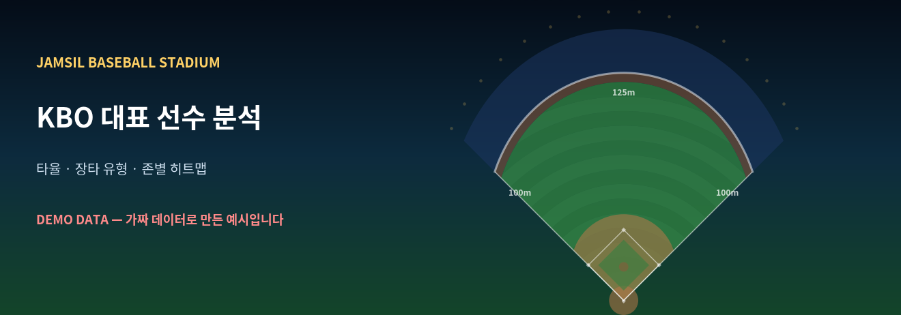
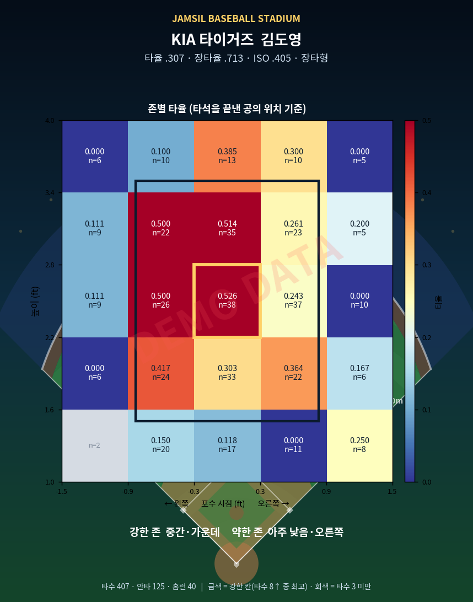
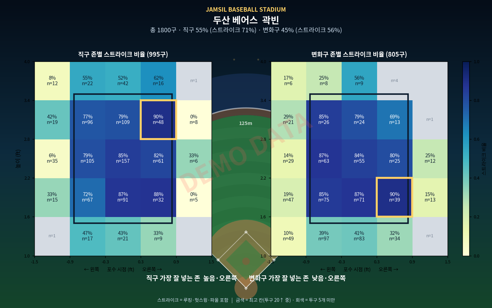
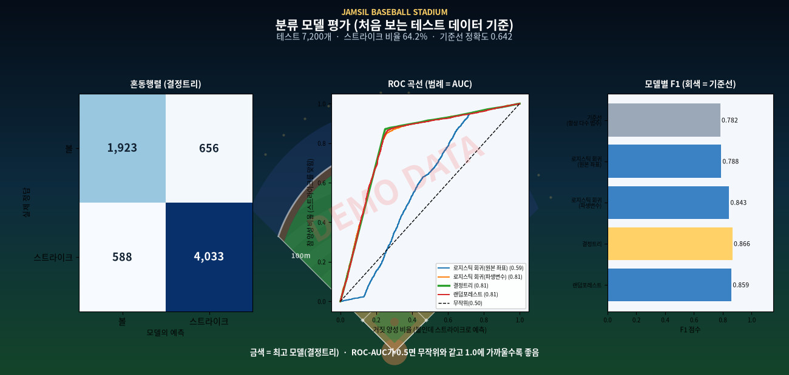

# ⚾ KBO 대표 선수 히트맵 · 잠실야구장 에디션

KBO 10개 구단의 대표 타자·투수를 골라 **타율, 장타형/단타형 구분, 존별 히트맵**을 만들어 주는 파이썬 프로그램입니다.
모든 그림은 **잠실야구장의 밤**(필드, 좌우 100m·중앙 125m 펜스, 관중석, 조명)을 배경으로 그려집니다.



> ⚠ **README의 그림은 모두 가짜(DEMO) 데이터로 만든 예시입니다.** 실제 선수의 기록이 아닙니다.
> 실제 투구 데이터를 넣는 방법은 [데이터](#데이터) 절을 보세요.

| 타자: 존별 타율 | 투수: 직구/변화구 존별 스트라이크 |
|---|---|
|  |  |

## 무엇을 해 주나요

| 대상 | 결과 |
|---|---|
| 타자 | 타율, 장타율, ISO, **장타형/단타형**, 5×5 존별 타율 히트맵, 강한 존/약한 존 |
| 투수 | 직구/변화구 비율·스트라이크율, 존 안에 넣는 비율, **직구·변화구를 잘 넣는 존** 히트맵 |
| 전체 | CSV 요약표 2개 + 한 장짜리 HTML 대시보드(`output/index.html`) |

## 빠른 시작

```bash
git clone <이 저장소 주소>
cd kbo-jamsil-heatmap
pip install -r requirements.txt        # numpy, pandas, matplotlib, scikit-learn, streamlit

python -m kbo_heatmap --demo          # 가짜 데이터로 전체 흐름 시험 (약 10초)
streamlit run app.py                   # 웹앱
```

결과는 `output/` 폴더에 생깁니다. `output/index.html`을 브라우저로 여세요.

```text
output/
├── index.html            대시보드
├── field.png             잠실야구장 배너
├── batter_summary.csv    타자 요약
├── pitcher_summary.csv   투수 요약
└── figures/              선수별 히트맵 PNG
```

## 🖥 Streamlit 웹앱

```bash
streamlit run app.py
```

브라우저에서 구단·선수를 고르면 히트맵과 지표가 바로 바뀝니다.

| 기능 | 설명 |
|---|---|
| 데이터 선택 | **DEMO(가짜)** 또는 **내 CSV 업로드**. 업로드 전·오류 시에는 DEMO를 보여줍니다 |
| 설정 | 히트맵 3×3 / 5×5, 장타형 기준(ISO) 슬라이더 |
| 탭 | 선수 히트맵 · 전체 요약표(CSV 내려받기) · 사용법/데이터 형식 |
| 안전장치 | 잘못된 CSV는 오류 문구만 띄우고 앱은 계속 동작, 그림 하나가 실패해도 다른 화면은 정상 |

### Streamlit Community Cloud에 배포하기

1. 이 저장소를 GitHub에 올립니다.
2. [share.streamlit.io](https://share.streamlit.io) → **New app** → 저장소/브랜치(`main`) 선택, **Main file path**에 `app.py` 입력.
3. 저장소 루트의 `requirements.txt`(파이썬 패키지)와 `packages.txt`(한글 폰트 `fonts-nanum`)를 서버가 자동으로 설치합니다.

주의
- 투구 데이터 CSV를 **저장소에 올리지 마세요**. 앱에서 업로드해 쓰면 됩니다(`.gitignore`가 `data/pitches*.csv`를 막아 둡니다).
- 업로드한 파일은 서버에 저장하지 않고 세션 메모리에서만 쓰지만, 공개 앱이라면 누구나 접속할 수 있다는 점을 염두에 두세요.
- 한글이 깨지면 `packages.txt`가 배포에 반영되었는지 확인하고, 필요하면 환경변수 `KBO_FONT_PATH`에 폰트 파일 경로를 지정하세요.

### 실제 데이터로 실행

```bash
python -m kbo_heatmap --data data/pitches_2026.csv
```

### 옵션

| 옵션 | 설명 |
|---|---|
| `--teams KIA,LG` | 일부 구단만 처리 (코드: KIA, SAMSUNG, LG, DOOSAN, KT, SSG, LOTTE, HANWHA, NC, KIWOOM) |
| `--grid 3` | 히트맵을 3×3으로 (표본이 적을 때 추천, 기본 5) |
| `--iso-threshold 0.18` | 장타형 기준 변경 (기본 0.160) |
| `--players my_players.json` | 대표 선수 설정 파일 변경 |
| `--out DIR` | 결과 폴더 (기본 `output`) |
| `--font-path FILE` | 한글 폰트 직접 지정 (글자가 깨질 때) |
| `--no-dashboard` | HTML 대시보드 생략 |
| `-v` | 진행 로그 출력 |

## 🎯 분류 모델: 스트라이크 / 볼

투구 **위치와 구종**만 보고 스트라이크인지 볼인지 맞히는 **이진 분류 모델**을 학습·평가합니다.
정답(라벨)은 `is_strike`이고, 5개 모델(기준선, 로지스틱 회귀 2종, 결정트리, 랜덤포레스트)을 같은 조건에서 비교합니다.

```bash
python -m kbo_heatmap.classify_cli --demo                      # 가짜 데이터로 시험 (약 20초)
python -m kbo_heatmap.classify_cli --data data/pitches_2026.csv # 실제 데이터
```

| 결과 파일 (`output_classification/`) | 내용 |
|---|---|
| `evaluation.png` | 혼동행렬 · ROC 곡선 · 모델별 F1 |
| `probability_map.png` | 직구/변화구별 스트라이크 확률 지도 (잠실 배경, 결정 경계 표시) |
| `metrics.csv` | 모델별 정확도·정밀도·재현율·F1·ROC-AUC·교차검증 |
| `classification_report.md` | 문제 정의 · 방법 · 결과 · 해석 · 한계를 정리한 한글 보고서 |

- 웹앱의 **"분류 모델 (스트라이크/볼)"** 탭에서도 버튼 하나로 실행됩니다.
- 설명은 [`docs/CLASSIFICATION_GUIDE.md`](docs/CLASSIFICATION_GUIDE.md)에 있습니다(분류가 뭔지, 지표 읽는 법, 예상 질문과 답, 제출 체크리스트).

**투구 위치 데이터가 없다면?** KBO는 공개하지 않지만 MLB Statcast는 실제 데이터를 공개합니다. Baseball Savant에서 받은 CSV를
`python -m kbo_heatmap.statcast --from-csv savant.csv --out data/pitches_statcast.csv`로 변환해 쓸 수 있습니다
(자세한 방법은 가이드 8번). 보고서에는 MLB 데이터를 썼다고 정확히 적어야 합니다.



> ⚠ `--demo` 수치는 **무작위로 만든 가짜 값**입니다. 제출용 분석에 쓰면 안 됩니다. (그림에 DEMO 워터마크가 들어갑니다)

## 데이터

타율·장타 유형은 기록만 있으면 되지만, **히트맵은 투구마다의 위치 좌표가 필요**합니다.
KBO는 MLB의 Statcast처럼 공개 API를 제공하지 않아서, 이 부분은 직접 구해야 합니다.

- CSV 형식: [`data/README.md`](data/README.md) · 예시 파일: [`data/pitches_template.csv`](data/pitches_template.csv)
- 출처와 주의사항: [`docs/DATA_SOURCES.md`](docs/DATA_SOURCES.md)

필수 컬럼은 `pitcher, batter, pitch_type, (plate_x, plate_z 또는 zone), is_strike, pa_result` 입니다.

## 대표 선수 바꾸기

`data/players.json`을 고치면 됩니다. 구단마다 `batters`, `pitchers` 목록을 두며, 타자가 없는 구단은 `[]`로 두세요(키움이 그 예).

```json
{"code": "KIA", "name": "KIA 타이거즈",
 "batters":  [{"name": "김도영"}, {"name": "나성범"}],
 "pitchers": [{"name": "올러"},   {"name": "네일"}]}
```

- 선수 이름은 데이터 CSV의 `batter` / `pitcher` 값과 **글자 그대로** 같아야 합니다.
- `"verified": false`로 두면 대시보드에 ⚠ 표시가 붙습니다(2026 기록을 확인하지 못한 선수).
- 현재 설정은 2026 시즌 기록(MyKBO Stats, 10월 14일 기준)을 바탕으로 고른 후보입니다. 타자는 구단별 OPS 상위 2명,
  투수는 평균자책점·탈삼진 상위 선수이며, 안우진·김광현·아빌라·류현진·왕옌청·소형준은 기록을 확인하지 못했습니다.

## 지표 정의

| 지표 | 계산 |
|---|---|
| 타율 | 안타 ÷ 타수 (볼넷·사구·희생 타석은 타수에서 제외) |
| 장타율 | 총 루타 ÷ 타수 |
| ISO | 장타율 − 타율 (순수한 장타력) |
| 유형 | ISO ≥ 0.160 → **장타형**, 미만 → **단타형** (`--iso-threshold`로 변경) |
| 표본 부족 | 타수 50 미만이면 유형 옆에 "표본 부족" 표시 |
| 존별 타율 | 타석을 끝낸 투구의 위치별 안타 비율. 칸당 타수 3 미만은 회색 |
| 강한/약한 존 | 칸당 타수 8 이상인 칸 중 타율 최고/최저 (작은 표본이 1등이 되는 것을 방지) |
| 존별 스트라이크율 | 구종별 위치마다 (스트라이크 ÷ 투구). 칸당 5구 미만은 회색 |
| 잘 넣는 존 | 칸당 20구 이상인 칸 중 스트라이크율 최고 |

기준값은 모두 [`kbo_heatmap/config.py`](kbo_heatmap/config.py)에 있습니다. **장타형 0.160은 임의로 정한 값**이므로 실제 데이터의
분포(리그 평균 등)를 보고 조정하세요.

### 히트맵 읽는 법

- 좌표는 **포수 시점**입니다. 왼쪽은 포수가 보는 왼쪽(오른쪽 타자 기준 몸쪽)이고, 타자의 좌우 타석은 구분하지 않습니다.
- 굵은 검은 사각형이 대략적인 스트라이크존, **금색 테두리**가 가장 강한 칸입니다.
- 범위(좌우 ±1.5ft, 높이 1~4ft) 밖의 공은 가장자리 칸에 포함됩니다.

## 프로젝트 구조

```text
app.py             Streamlit 웹앱
packages.txt       Streamlit Cloud용 시스템 패키지(한글 폰트)
.streamlit/        웹앱 테마·업로드 설정
kbo_heatmap/
├── config.py      분석 기준, 좌표 범위, 구장 규모
├── data.py        선수 설정 · CSV 로딩/검증 · 데모 데이터
├── metrics.py     타율/ISO/존별 통계 (그림과 무관한 순수 계산)
├── classify.py    스트라이크/볼 분류 모델 학습·평가·보고서
├── classify_plots.py  분류 결과 그림 (확률 지도, 평가)
├── classify_cli.py    분류 실행 (python -m kbo_heatmap.classify_cli)
├── statcast.py    MLB Statcast CSV를 이 프로젝트 형식으로 변환
├── tables.py      요약표 행 만들기 (CLI와 웹앱 공용)
├── stadium.py     잠실야구장 배경 그리기
├── plots.py       타자/투수 히트맵
├── render.py      그림을 PNG bytes로 (웹앱용, 스레드 안전)
├── dashboard.py   HTML 대시보드
└── cli.py         명령줄 진입점
tests/             pytest 70개 (지표 손계산, 데이터 검증, 분류 모델, Statcast 변환, 웹앱 38명 전원 렌더링, CSV 업로드)
data/              players.json, CSV 형식 안내
docs/              데이터 출처 문서, README 이미지
```

## 테스트

```bash
pip install -r requirements-dev.txt
python -m pytest -q
```

개발 환경은 Python 3.12 / numpy 2.4 / pandas 3.0 / matplotlib 3.10 / scikit-learn 1.9 / Streamlit 1.66에서 검증했고, pandas 2.3 · matplotlib 3.8 ·
scikit-learn 1.5 · Streamlit 1.40 조합에서도 통과했습니다(Streamlit 1.40의 테스트 도구는 파일 업로드를 흉내 내지 못해 업로드 테스트 8개는 건너뜀).
GitHub Actions(`.github/workflows/ci.yml`)가 Python 3.10~3.12에서 테스트와 데모 실행을 돌리도록 구성했지만, 3.10·3.11과
**실제 Streamlit Community Cloud 배포는 아직 해 보지 못했습니다**(로컬 서버 기동과 자동 UI 테스트로만 확인).

## 한계

- 투구 위치 데이터는 포함되어 있지 않습니다(위 [데이터](#데이터) 참고). `--demo`의 수치는 **무작위로 만든 값**입니다.
- 한 시즌 기준으로는 칸당 표본이 작아 히트맵이 들쭉날쭉할 수 있습니다. `--grid 3`이나 여러 시즌 합산을 고려하세요.
- 좌/우타자, 좌/우투수 구분, 카운트별 분석은 아직 없습니다.
- 분류 모델은 위치·구종만 씁니다(스윙 여부, 볼카운트, 타자 키 등은 미반영). `pybaseball`로 Statcast를 내려받는 부분은
  이 개발 환경에서 인터넷이 막혀 있어 **직접 실행해 보지 못했고**(변환·오류 처리 로직만 테스트), Savant CSV 변환 방식이 더 확실합니다.
- 잠실야구장 배경은 필드 기하 구조를 형상화한 일러스트이고, 구장 규모(좌우 100m·중앙 125m)는 근사값입니다.

## 라이선스와 면책

코드는 MIT 라이선스입니다. 이 프로젝트는 KBO, 구단, 구장 운영 주체와 무관한 **비공식 학습용 프로젝트**이며, 구단 로고나 공식
사진을 사용하지 않습니다. 선수 기록은 공개된 순위표를 참고용으로 옮긴 것이므로 정확한 최종 기록은 KBO 공식 기록실에서
확인하세요.
